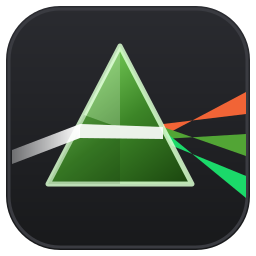
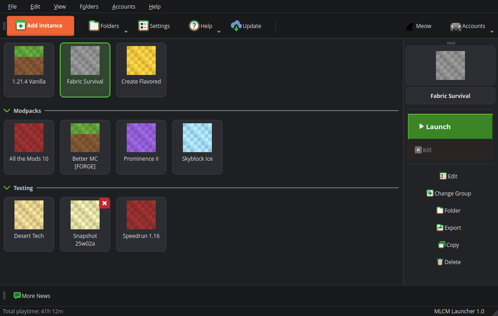
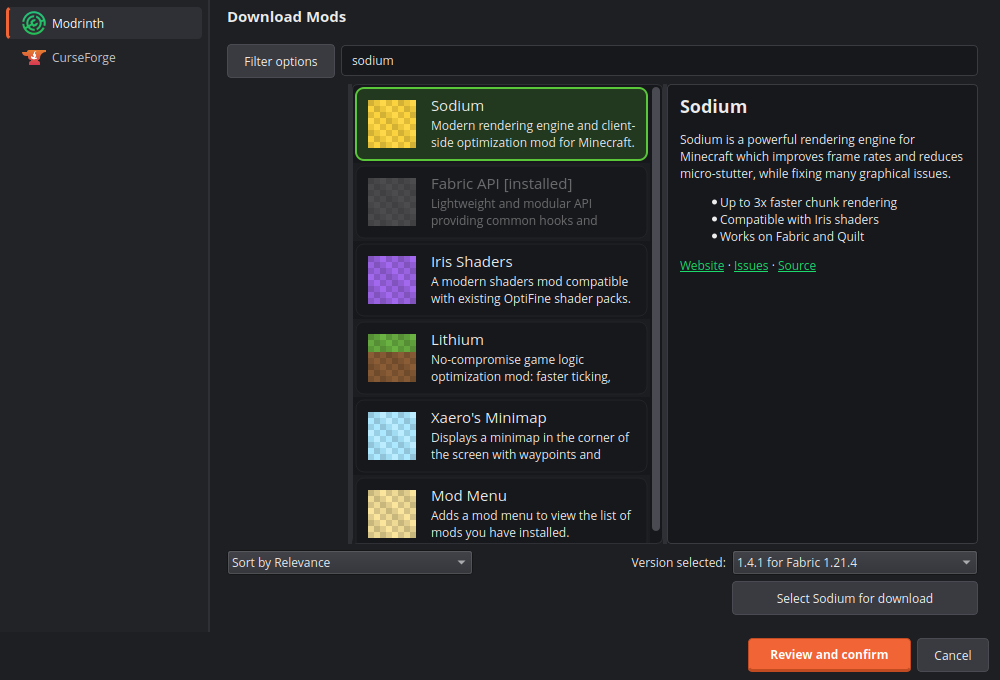
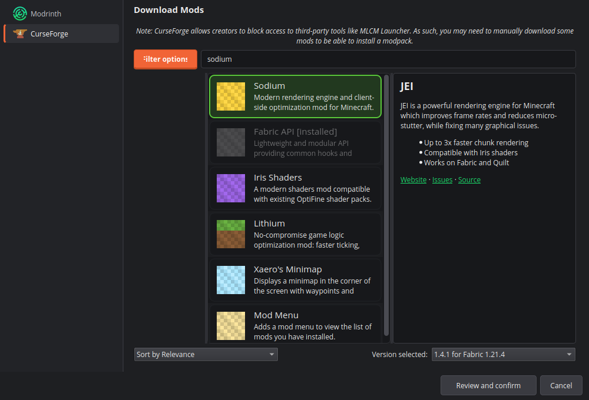
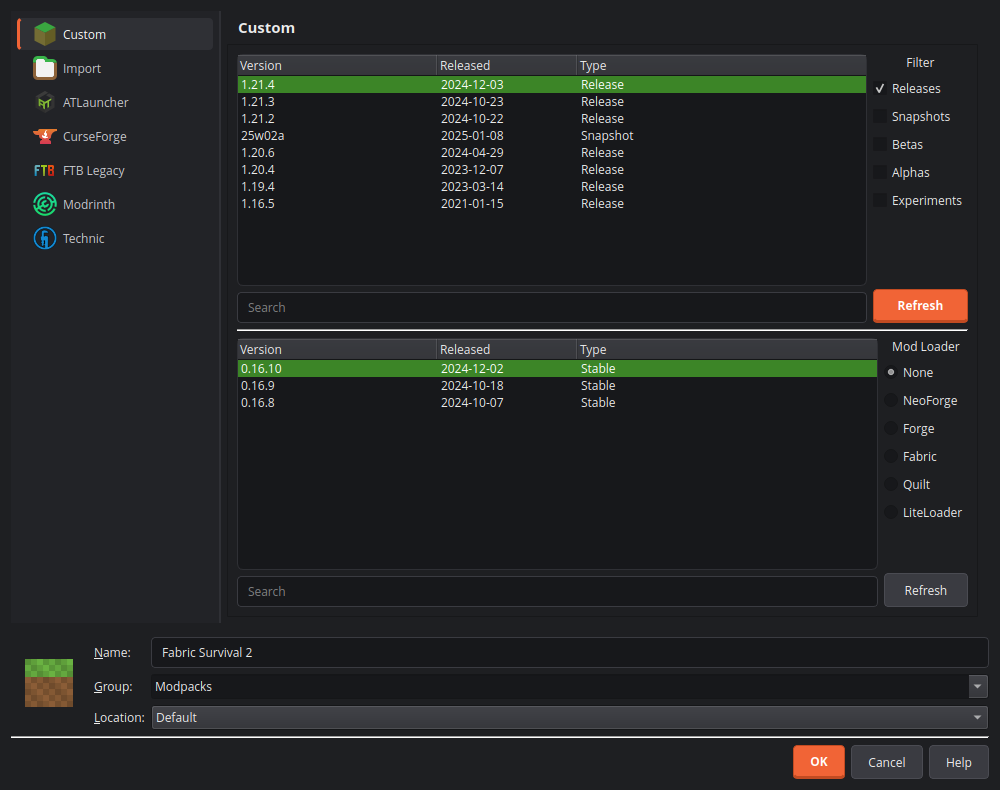
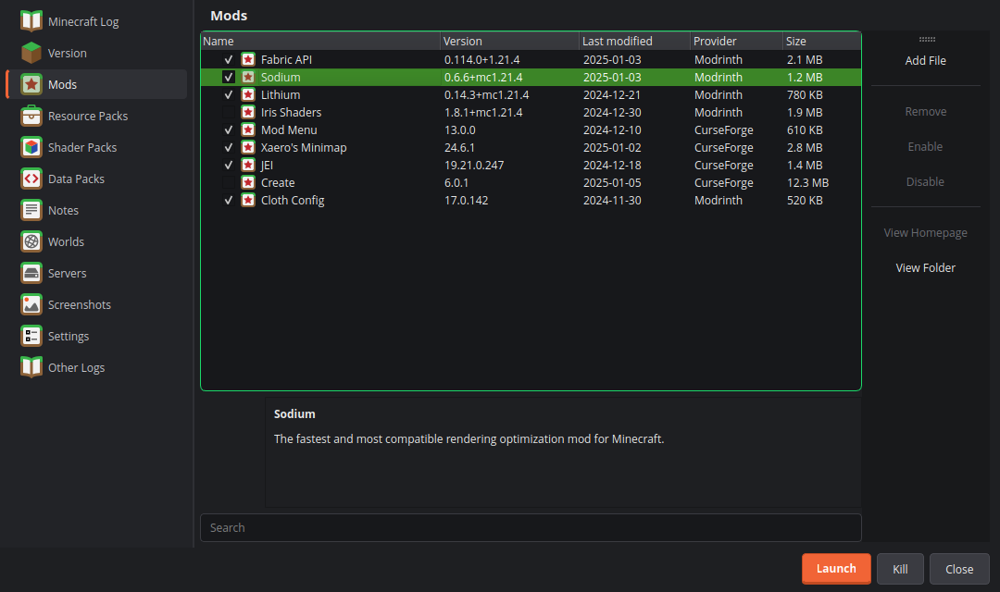
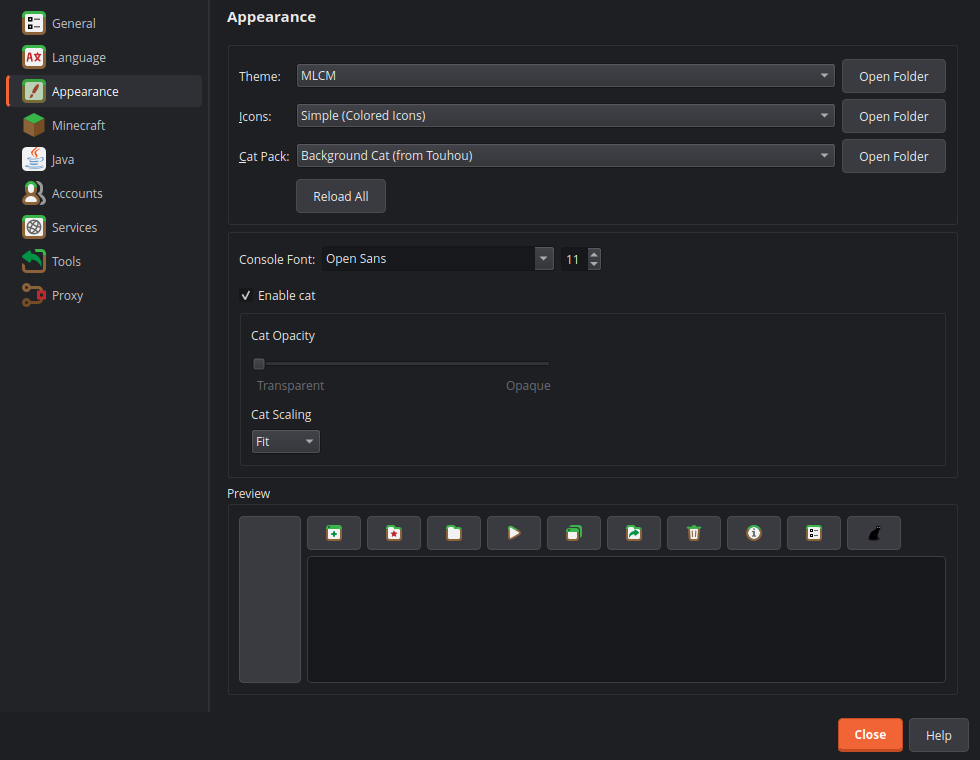

<p align="center">
  
</p>

<h1 align="center">MLCM Launcher</h1>

<p align="center">
  以 <a href="https://github.com/PrismLauncher/PrismLauncher">Prism Launcher</a> 為核心、外觀完全重做的 Minecraft 啟動器。<br>
  <sub>A Windows-first Minecraft launcher: Prism Launcher's engine with a redesigned interface.</sub>
</p>

---

## 這是什麼

MLCM Launcher 是 Prism Launcher 的分支（fork）。**啟動、實例管理、模組載入、帳號登入等核心邏輯沿用 Prism Launcher，不做改動**；這個專案只重做使用者介面。

目前**只支援 Windows**。Linux 與 macOS 的打包、安裝與建置設定都已移除。

資料與設定放在自己的資料夾 `%APPDATA%\mlcmLauncher`，**不會跟 Prism Launcher 共用**，兩個程式可以並存。

> 專案仍在開發中。介面主要畫面已經換新，但部分對話框與設定頁只套用新配色，版面還是 Prism 原樣。

## 設計

介面風格由三個來源混合而成：

| 比例 | 來源 | 用在哪裡 |
| --- | --- | --- |
| 60% | Minecraft Launcher | 深炭灰底色、立體草綠色「啟動」按鈕、經驗條風格的進度條、偏方正的控制項 |
| 20% | CurseForge | 橘色行動按鈕（新增實例、對話框預設按鈕）、分頁與側邊欄的橘色選中指示 |
| 20% | Modrinth | 圓角卡片（實例列表、模組瀏覽結果）、亮綠色聚焦框、細圓角滾動條 |

主要改動：

- **MLCM 主題**：全新的調色盤與樣式表，是新安裝時的預設主題。已經選過其他主題的使用者要到「設定 → 外觀」自行切換。
- **實例列表**：每個實例是一張圓角卡片，選中時有亮綠色外框。
- **右側工具列**：「啟動」是大型綠色按鈕，「強制結束」是紅色按鈕。
- **模組瀏覽**：CurseForge／Modrinth 搜尋結果改為圓角卡片。
- **應用程式圖示**：原創的稜鏡圖示——一道白光穿過綠色玻璃稜鏡，折射成橘色與兩種綠色。

## 截圖

<p align="center">
  
</p>

| 模組瀏覽（Modrinth） | 模組瀏覽（CurseForge） |
| --- | --- |
|  |  |

| 新增實例 | 實例的模組頁 | 外觀設定 |
| --- | --- | --- |
|  |  |  |

完整截圖見最下方的[下載連結](#下載截圖)。

## 與 Prism Launcher 同步

- **第一次啟動**：如果偵測到 `%APPDATA%\PrismLauncher`，會詢問是否把資料搬過來（實例、帳號、設定、圖示、資產等）。選「否」之後不會再問。搬過來的設定會改用 MLCM 主題。
- **視窗底部的「Sync with Prism Launcher」按鈕**：之後想把 Prism Launcher 新增的實例帶過來時按它。
  - 單向：Prism Launcher → mlcmLauncher。**不會修改 Prism Launcher 的資料**。
  - 只複製這裡還沒有的實例，連同它們的分組與自訂圖示；已存在的實例不會被覆蓋，也不會刪除任何東西。
  - 找不到 Prism Launcher 資料夾時，可以手動選擇。
  - 帳號與設定只在第一次啟動時搬移，按鈕不會處理它們。

## 取得程式

目前沒有正式發佈版本。可以從 GitHub Actions 下載最新的 Windows 建置：

1. 打開本倉庫的 **Actions** 分頁，選 **Build**。
2. 進入最近一次成功的執行紀錄。
3. 在頁面最下方的 **Artifacts** 下載 Windows 版，解壓後執行。

## 自行建置

需求：

- Windows 10 / 11 x64
- Visual Studio 2022（含「使用 C++ 的桌面開發」）
- Qt 6.11（MSVC 2022 64-bit），CI 使用 6.11.2
- CMake 與 Ninja
- Git（需要拉取子模組：`libnbtplusplus` 與 `vcpkg`）

在「Developer PowerShell for VS 2022」中執行：

```powershell
git clone --recurse-submodules https://github.com/neil289506-commits/mlcmLauncher
cd mlcmLauncher

cmake --preset windows_msvc `
  -D CMAKE_PREFIX_PATH="C:\Qt\6.11.2\msvc2022_64" `
  -D VCPKG_HOST_TRIPLET=x64-windows `
  -D VCPKG_TARGET_TRIPLET=x64-windows

cmake --build --preset windows_msvc --config Release
```

第一次設定會透過 vcpkg 編譯相依套件，需要比較久的時間。實際可行的建置流程以 `.github/workflows/build.yml` 為準。

## 專案結構

| 路徑 | 內容 |
| --- | --- |
| `launcher/ui/themes/` | 主題系統；`MlcmTheme.*` 是 MLCM 主題（調色盤與樣式表） |
| `launcher/ui/instanceview/` | 實例列表，卡片繪製在 `InstanceDelegate.cpp` |
| `launcher/ui/widgets/ProjectItem.cpp` | 模組瀏覽結果卡片 |
| `launcher/ui/dialogs/PrismSync.*` | 底部「同步」按鈕的功能（從 Prism Launcher 帶入新實例） |
| `program_info/` | 品牌資源：`mlcm.ico`（Windows 圖示，在 `program_info/CMakeLists.txt` 宣告）、應用程式 SVG、安裝程式範本；名稱（`mlcmLauncher`）也在這裡的 `CMakeLists.txt` 設定 |
| `libraries/` | 內建函式庫 |

## 注意事項

- **微軟帳號登入**沿用 Prism Launcher 預設的 Client ID，它只接受 `prismlauncher://` 這個回呼網址，所以 `Launcher_URL_SCHEME` 預設是 `prismlauncher`（只影響登入回呼與匯入連結，資料夾與執行檔名稱都已改成 mlcmLauncher）。如果你註冊了自己的 Azure 應用程式，可以在 CMake 設定 `Launcher_MSA_CLIENT_ID` 與 `Launcher_URL_SCHEME`。
- 內建更新器指向本倉庫的 Releases，不會再去下載 Prism Launcher 的版本。

## 授權與致謝

- 本專案以 **GPL-3.0-only** 授權，見 [`LICENSE`](LICENSE) 與 [`COPYING.md`](COPYING.md)。
- `program_info/` 資料夾內的標誌與品牌資源依 **CC BY-SA 4.0** 授權，見 [`program_info/LICENSE`](program_info/LICENSE)。
- 核心程式碼來自 [Prism Launcher](https://github.com/PrismLauncher/PrismLauncher) 及其前身 PolyMC 與 MultiMC 的貢獻者，感謝他們的工作。
- 本專案**不是** Prism Launcher、Mojang、Microsoft、CurseForge 或 Modrinth 的官方產品，也未獲得他們的背書。「Minecraft」是 Mojang Studios 的商標；CurseForge 與 Modrinth 的名稱僅用來說明設計靈感的來源。

## 下載截圖

完整的介面截圖（主視窗、實例編輯、設定、各種對話框）打包成一個壓縮檔：

**[⬇ 下載 mlcmLauncher_screenshots.zip](https://github.com/neil289506-commits/mlcmLauncher/raw/develop/docs/mlcmLauncher_screenshots.zip)**
